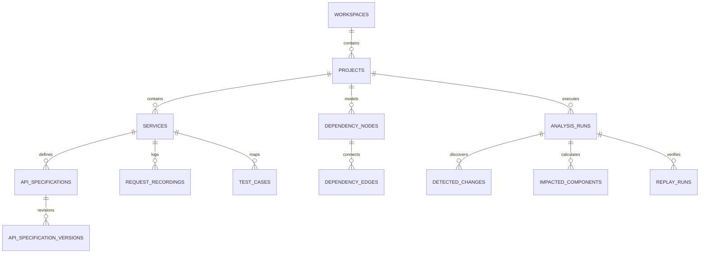

# TraceWeaver Database Schema & Entity Relationships

The relational schema is implemented in PostgreSQL with strong foreign key constraints, UUID primary keys, and specialized indexing.

---

## Entity Relationship Overview

---

## Key Tables

### `dependency_nodes`
- `id UUID PK`: Unique node identifier
- `project_id UUID FK`: Scopes graph to project isolation
- `node_key VARCHAR(255)`: Unique key within project (e.g. `service:order_service`, `op:getUserById`)
- `node_type VARCHAR(50)`: `SERVICE`, `API_OPERATION`, `SCHEMA_OBJECT`, `SCHEMA_FIELD`, `CLIENT`, `TEST_CASE`
- `name VARCHAR(255)`: Human-readable label
- `metadata JSONB`: Dynamic attributes (criticality, environment, parameters)

### `dependency_edges`
- `id UUID PK`: Edge identifier
- `project_id UUID FK`: Scoped project
- `source_node_id UUID FK`: Origin node
- `destination_node_id UUID FK`: Destination node
- `relationship_type VARCHAR(50)`: `SERVICE_DEPENDS_ON_SERVICE`, `OPERATION_CALLS_OPERATION`, etc.
- `weight DOUBLE PRECISION`: Edge traversal weight

### `detected_changes`
- `id UUID PK`: Change event ID
- `analysis_run_id UUID FK`: Owning analysis execution
- `change_type VARCHAR(100)`: Enum mapping to diff engine
- `compatibility VARCHAR(50)`: `BREAKING`, `POTENTIALLY_BREAKING`, `NON_BREAKING`
- `severity VARCHAR(50)`: `CRITICAL`, `HIGH`, `MEDIUM`, `LOW`, `INFO`
- `json_pointer VARCHAR(512)`: Precise RFC 6901 path in specification
- `old_value TEXT`: Baseline definition
- `new_value TEXT`: Mutated definition
- `reason TEXT`: Explanation of consumer impact
